# rgg

A fast TUI for finding text in files (ripgrep engine) and jumping to VS Code at the match.



```
rgg [PATH] [-t TYPE]... [--regex]
```

- Type to search (live). ↑↓ select, Enter opens VS Code with the repo folder at the file and line.
- Ctrl+R literal/regex · Ctrl+T file types · Ctrl+O settings · Ctrl+L per-file/per-match list · Alt+W wrap · Alt+P hide/show preview · Alt+←/→ or drag the pane border to resize · Alt+↑/↓ search history · F1 help.
- Config: `%USERPROFILE%\.rgg\config.toml`. File types, hidden, ignored and mode are remembered per git root.

See [docs/design.md](docs/design.md) and [docs/mockup.md](docs/mockup.md).

## Build

```
cargo build --release
```

The binary is `target/release/rgg.exe`. Install it on PATH with `cargo install --path .`.

On Windows, Rust needs the MSVC linker ("Desktop development with C++" in Visual Studio).

## Demo

`docs/demo.svg` and `docs/screenshot.svg` are rendered from the real UI with scripted key presses (no screen recorder needed):

```
cargo run --release --example demo
```
